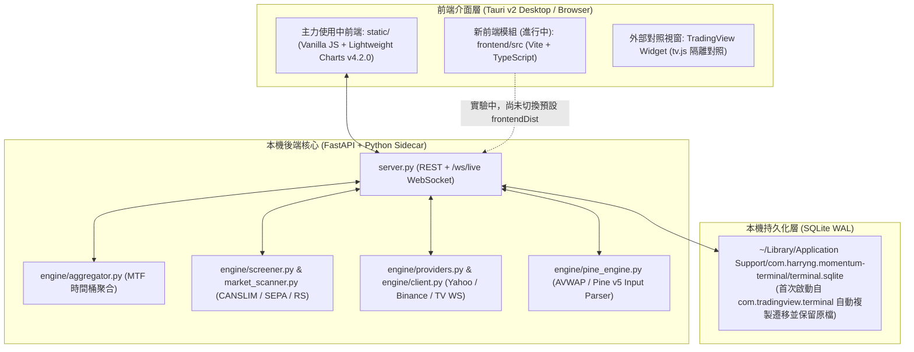

# Momentum Swing Terminal (v1.1.0)

個人與動能波段交易者專用桌面金融終端（macOS Tauri v2 + FastAPI Sidecar + Lightweight Charts），聚焦 CANSLIM、Minervini SEPA、Weinstein Stage 2 與 Qullamaggie 交易工作流。

## Architecture



## Development Setup

前置工具：Python 3.9+（建議專案根目錄 `.venv`）、Node.js 22+、Rust / Cargo（Tauri v2）。

```bash
# 安裝 Python 與 Node 依賴
python3 -m venv .venv
.venv/bin/pip install -r requirements-dev.txt
npm ci

# 啟動 Web 開發模式（後端 8000 + Vite）
npm run dev:web

# 或啟動 Tauri 桌面開發視窗
npm run tauri:dev
```

## Testing

```bash
# Python 後端與整合測試（排除需連網之 e2e 與 stress 測試）
.venv/bin/python -m pytest -q --ignore=tests/test_e2e_live.py --ignore=tests/stress_websocket.py -rs

# TypeScript 型別檢查與 Vitest 單元測試（frontend/src）
npm run typecheck
npm run test:fe
```

基準測試紀錄詳見 [docs/BASELINE.md](docs/BASELINE.md)。

## Packaging & Build

```bash
# 僅建置 PyInstaller Python sidecar 至 dist/server-sidecar 與 src-tauri/bin
npm run build:sidecar

# 建置簽章版 macOS .app 與動態衍生版本號的 .dmg（依 package.json version 與 productName）
npm run build:desktop
```

## Data Source Risk & Attribution

- **資料來源風險聲明**：本專案行情資料透過本機後端向 Yahoo Finance、Binance 公開介面與 TradingView WebSocket 擷取，僅供個人研究與本地分析使用，無任何即時性、完整性或投資績效保證；請勿用於商業行情再分發或高頻實盤下單決策。
- **上游開源致謝**：即時 WebSocket 協議層衍生自 [Hattorius/Tradingview-ticker](https://github.com/Hattorius/Tradingview-ticker)，原上游 README 完整保留於 [docs/UPSTREAM_TICKER_README.md](docs/UPSTREAM_TICKER_README.md)。
- **授權條款**：依 GNU GPLv3 授權條款釋出，詳見 [LICENSE](LICENSE)。
