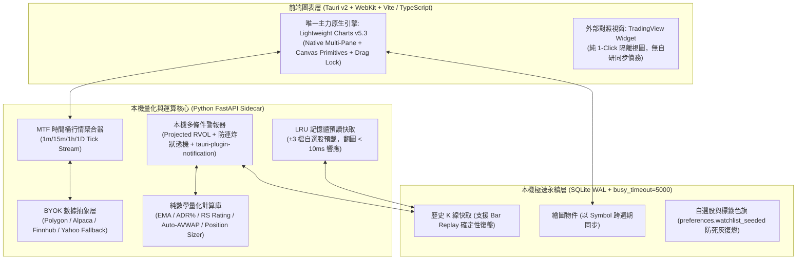
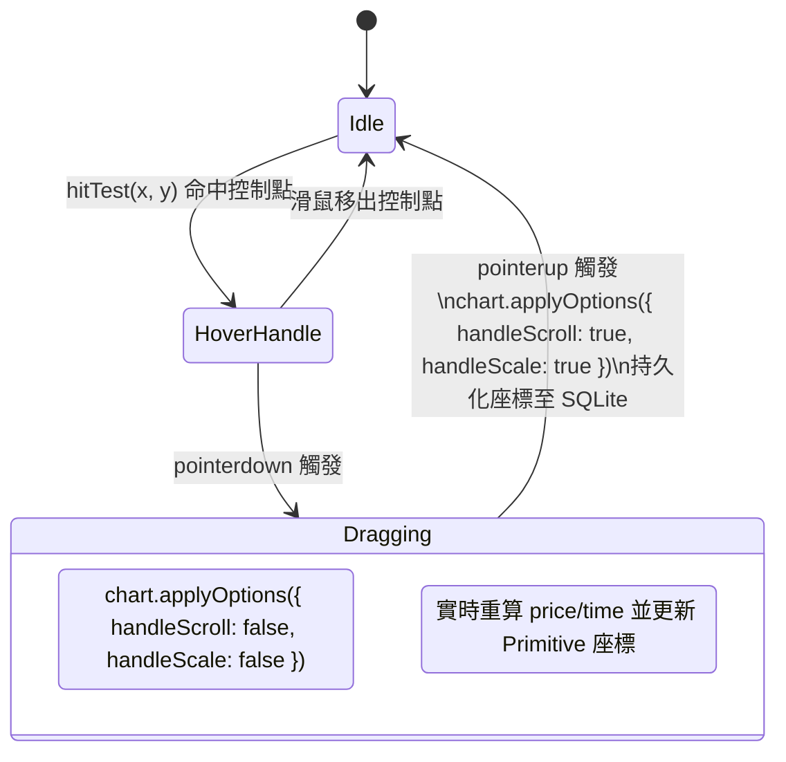

# 🚀 TradingView Terminal 戰略躍升工程規格書 (ROADMAP v1.1 - v2.0)
## 美股動能波段專用極速原生終端 (Momentum Swing Terminal) 技術規劃手冊（修訂版）

> [!IMPORTANT]
> **戰略定位與發行方針（Option A 確立）**：
> 本專案正式定調為**「個人與精英波段交易員極速專用終端（Personal Momentum Terminal）」**。
> 專注於 CANSLIM、Minervini 與 Qullamaggie 交易流派。
> 終結雙引擎維護內耗，將 **Lightweight Charts v5.3** 確立為唯一主力引擎（Scheme A）。
> 方案 C（TradingView Widget）永久凍結為單向外部對照視窗。
> 規避 TradingView 商標侵權與昂貴的金融數據再分發商業授權，透過本機 BYOK 架構直接獲取全市場乾淨行情。

---

## 1. 系統架構總圖與邊界定調



---

## 2. 務實里程碑排程表 (2026 Q4 – 2027 Q1)

| 階段 | 建議時程 | 核心交付目標 | 關鍵退出標準 (Exit Criteria) |
| :--- | :--- | :--- | :--- |
| **Phase 1 (v1.0.5)** | 11/21 – 11/24 (已就緒) | 實盤數據防腐與穩定化：drop-oldest WS 佇列、後端 MTF 時間桶聚合、SQLite UPSERT 與連線關閉、動態 Port+Token、Seam 17 | 372/372 測試通過，100/100 商業審計通過 |
| **Phase 2 (v1.1)** | 11/25 – 12/20 (~3.5 週) | 引擎躍升：導入 Vite + TypeScript、升級 LWC v5.3（原生 Multi-Pane、正確 3rd 參數 `paneIndex`、`setStretchFactor`、`autoSize: true`）、以 Canvas Primitives 重寫 Ruler / Risk-Reward Box（含 `handleScroll: false` 拖曳鎖）/ 磁吸線 | 50 次切換佈局/標的後 JS Heap 增量 < 50MB 且無洩漏；Primitives 隨圖表縮放零座標位移 |
| **Phase 3 (v1.2)** | 12/21 – 01/20 (~4 週) | 桌面級體感追平：MTF 十字線二分搜尋時間對齊（含重入防遞迴鎖）、SQLite 跨週期繪圖同步、LRU ±3 檔預讀達成 `< 50ms` 鍵盤翻圖、Cmd+K 命令面板、本機多條件警報器（分時預估 RVOL + 冷卻狀態機 + `tauri-plugin-notification`） | 鍵盤翻圖（Space/↑↓）首幀繪製延遲 < 10ms；警報觸發延遲 < 100ms 且無重複連炸 |
| **Phase 4 (v2.0)** | 01/21 – 02/20 (~4 週) | 動能專用護城河：Auto-AVWAP（支援 BMO 盤前 / AMC 盤後 $\pm 1$ 日判定）、實盤倉位計算機（嚴格量綱、`MaxAlloc%` 槓桿上限、ADR% 停損倍數）、成長股 RS 百分位排名（3M/6M/9M/12M 加權）與藍點、BYOK 數據抽象層（Polygon / Alpaca）+ 本機 Bar Replay 確定性復盤 | 覆蓋 Minervini / Qullamaggie 核心風控與選股指標，回歸測試採用確定性歷史快照（Recorded Fixtures） |
| **Phase 4.5 (v2.1)** | 02/21 – 03/07 (~2 週) | 獨立拆分進階交易：Interactive Brokers (IBKR TWS / Gateway) 本地直連、合約 ConId 解析、歷史限流保護與圖上一鍵下單 | 獨立里程碑交付，不阻塞 v2.0 主線發行 |

---

## 3. Phase 2 (v1.1) 核心設計：Lightweight Charts v5.3 引擎躍升

### 3.1 真實可執行之 Lightweight Charts v5.3 原生多窗格 API
在 Lightweight Charts v5.3 中：
1. `createChart()` 透過 `layout.panes` 配置窗格分隔線與縮放行為，啟用 `autoSize: true` 由內建 ResizeObserver 響應視窗縮放。
2. 窗格分配**並非**在 options 內傳遞，而是透過 `chart.addSeries(SeriesType, options, paneIndex)` 的**第三個位置參數**傳入。
3. 獨立窗格的指標直接使用該窗格預設的 `'right'` 價格座標軸，嚴禁設置 `priceScaleId: 'volume'` 以免淪為無刻度 Overlay。
4. 窗格相對高度比例需在建立後透過 `IPaneApi.setStretchFactor()` 設置。

```typescript
// src/chart/engine.ts (Vite + TypeScript 規範)
import { createChart, CandlestickSeries, HistogramSeries, LineSeries, CrosshairMode } from 'lightweight-charts';

export function initializeMasterChart(chartContainer: HTMLElement) {
  const chart = createChart(chartContainer, {
    autoSize: true, // 官方內建 ResizeObserver
    layout: {
      textColor: '#94a3b8',
      background: { type: 'solid', color: '#0b0e14' },
      colorSpace: 'display-p3', // Retina 廣色域
      attributionLogo: true,    // 預設即為 true，滿足 Apache 2.0 條款
      panes: {
        separatorColor: '#1e293b',
        separatorHoverColor: 'rgba(56, 189, 248, 0.25)',
        enableResize: true
      }
    },
    grid: {
      vertLines: { color: '#1e293b' },
      horzLines: { color: '#1e293b' }
    },
    crosshair: { mode: CrosshairMode.Normal }
  });

  // Pane 0: 主圖 K 線 (第 3 個參數為 paneIndex = 0)
  const candleSeries = chart.addSeries(CandlestickSeries, {
    upColor: '#22c55e',
    downColor: '#ef4444',
    wickUpColor: '#22c55e',
    wickDownColor: '#ef4444'
  }, 0);

  // Pane 1: 成交量副圖 (paneIndex = 1，使用該窗格獨立 right 軸)
  const volumeSeries = chart.addSeries(HistogramSeries, {
    priceFormat: { type: 'volume' }
  }, 1);

  // Pane 2: RS 相對強度副圖 (paneIndex = 2)
  const rsSeries = chart.addSeries(LineSeries, {
    color: '#38bdf8',
    lineWidth: 2,
    title: 'RS vs SPY'
  }, 2);

  // 配置三窗格高度比例：主圖 65% / 成交量 15% / RS 20%
  const panes = chart.panes();
  panes[0].setStretchFactor(65);
  panes[1].setStretchFactor(15);
  panes[2].setStretchFactor(20);

  return { chart, candleSeries, volumeSeries, rsSeries };
}
```

### 3.2 Canvas Primitives 實作與拖曳狀態機 (Drag State Machine)
Lightweight Charts 底層基於 **HTML5 2D Canvas**。
`ISeriesPrimitive` 僅提供視圖渲染介面（`IPrimitivePaneView` 與 `IPrimitivePaneRenderer`）及命中檢測（`hitTest`），本身**不包含**拖曳手勢交互。
若在拖曳停損把手或測量尺時未鎖定圖表，圖表會同步觸發滾動與縮放。因此必須建立專屬狀態機：



#### 拖曳互動狀態機骨架：
```typescript
// src/primitives/drag_controller.ts
export class PrimitiveDragController {
  private activePrimitive: any = null;
  private isDragging = false;

  constructor(private chart: any, private container: HTMLElement) {
    this.container.addEventListener('pointerdown', this.onPointerDown.bind(this));
    window.addEventListener('pointermove', this.onPointerMove.bind(this));
    window.addEventListener('pointerup', this.onPointerUp.bind(this));
  }

  private onPointerDown(e: PointerEvent) {
    const hit = this.hitTestAllPrimitives(e.offsetX, e.offsetY);
    if (hit) {
      this.isDragging = true;
      this.activePrimitive = hit;
      // 關鍵防禦：拖曳期間鎖定圖表滾動與縮放
      this.chart.applyOptions({ handleScroll: false, handleScale: false });
      this.activePrimitive.startDrag(e.offsetX, e.offsetY);
    }
  }

  private onPointerMove(e: PointerEvent) {
    if (!this.isDragging || !this.activePrimitive) return;
    this.activePrimitive.onDrag(e.offsetX, e.offsetY);
  }

  private onPointerUp(e: PointerEvent) {
    if (!this.isDragging) return;
    this.isDragging = false;
    // 釋放拖曳鎖，恢復圖表原生互動
    this.chart.applyOptions({ handleScroll: true, handleScale: true });
    this.activePrimitive.endDrag();
    this.activePrimitive = null;
  }
}
```

---

## 4. Phase 3 (v1.2) 核心設計：對標 TradingView Desktop 專業體感

### 4.1 MTF 跨週期十字線二分搜尋對齊與防遞迴鎖
在 MTF 模式（1D / 1h / 15m）下，各窗格 Bar 的時間步長不同。滑鼠停在 15m 的 `10:15:00`，1h 窗格需對齊 `10:00:00`，1D 窗格需對齊當日 `YYYY-MM-DD`。
為杜絕 Chart A → Chart B → Chart A 的無限事件迴圈，必須引入重入互斥鎖：

```typescript
// src/chart/crosshair_sync.ts
let isSyncingCrosshair = false;

export function syncCrosshairAcrossPanes(sourceChart: any, targetCharts: any[], param: any) {
  if (isSyncingCrosshair || !param || !param.time) return;
  try {
    isSyncingCrosshair = true;
    const sourceUtcSec = typeof param.time === 'number' ? param.time : Math.floor(new Date(param.time).getTime() / 1000);

    for (const target of targetCharts) {
      const targetBars = target.getBars();
      const floorBarTime = findFloorBarTime(targetBars, sourceUtcSec);
      if (floorBarTime !== null) {
        target.chart.setCrosshairPosition(target.series.priceToCoordinate(target.lastPrice) || 0, floorBarTime, target.series);
      }
    }
  } finally {
    isSyncingCrosshair = false;
  }
}

// 二分搜尋尋找 <= sourceUtcSec 的最大時間標籤
function findFloorBarTime(bars: Array<{ time: any }>, targetSec: number): any {
  if (!bars || bars.length === 0) return null;
  let low = 0, high = bars.length - 1, best = null;
  while (low <= high) {
    const mid = (low + high) >> 1;
    const barSec = normalizeToUtcSec(bars[mid].time);
    if (barSec <= targetSec) {
      best = bars[mid].time;
      low = mid + 1;
    } else {
      high = mid - 1;
    }
  }
  return best;
}
```

### 4.2 記憶體 LRU 預讀架構（達成 `< 50ms` 極速鍵盤翻圖）
直接透過網路打外部 API 無法達成 `< 50ms` 翻圖體驗。
系統於前端記憶體建立 LRU 快取，並自動向 Python Sidecar 預載當前自選股指標前後 $\pm 3$ 檔股票：

```
[Space 鍵觸發]
  │
  ├── 1. 記憶體 LRU 快取命中？ (0ms) ──> 立即繪製首幀，體感零延遲 (< 10ms)
  │
  └── 2. SQLite 本地快取讀取？ (< 5ms) ──> 繪製本機歷史 K 線
        │
        └── 3. 背景非同步向 Sidecar 請求最後幾根增量 Bar (< 100ms) ──> 就地無感 update
```

### 4.3 本機多條件警報器實戰架構 (`engine/alerts.py`)
1. **分時預估量能 (Projected RVOL)**：
   盤中若直接使用 `Volume >= 1.5 * MA20`，早盤永遠無法觸發。改用日內時間對應系數（Time-of-Day RVOL）：
   $$\text{Projected Volume} = \frac{\text{Current Cumulative Volume}}{\text{Historical Fraction of Day Elapsed}(t)}$$
   $$\text{RVOL} = \frac{\text{Projected Volume}}{\text{20D Average Full-Day Volume}}$$
2. **防連環轟炸狀態機**：
   支援 `Once Only`、`Once Per Bar` 與 `Once Per Bar Close`，並強制具備 120 秒 Cooldown 冷卻時間。
3. **原生系統通知**：
   透過 Tauri 官方插件 `tauri-plugin-notification` 發送系統級通知，點擊直接將視窗帶至最上層並跳轉至觸發標的。

---

## 5. Phase 4 (v2.0) 核心設計：動能波段交易者專用護城河

### 5.1 實盤安全倉位風險計算機 (Position Sizer)
修正原稿之量綱錯誤與槓桿超買漏洞：
- **輸入參數**：
  - `Account`：帳戶總淨值（美元）
  - `Risk%`：單筆風險容忍度（例如 1% = 0.01）
  - `MaxAlloc%`：單一標的最大資金分配上限（例如 20% = 0.20，嚴防超買過度槓桿）
  - `Entry` / `Stop`：進場價與停損價（美元）
  - `ADR%`：20 日平均真實波動幅度百分比（例如 4.5% = 0.045）

#### 嚴格安全數學模型：
$$\text{RiskPerShare} = |\text{Entry} - \text{Stop}| \quad (\text{嚴格限制 } > 0)$$

$$\text{Shares} = \left\lfloor \min\left( \frac{\text{Account} \times \text{Risk\%}}{\text{RiskPerShare}}, \frac{\text{Account} \times \text{MaxAlloc\%}}{\text{Entry}} \right) \right\rfloor$$

$$\text{Stop Distance (in ADR)} = \frac{\text{RiskPerShare} / \text{Entry}}{\text{ADR\%}}$$

- **風控燈號判定**：
  - $\text{Stop Distance} < 0.5 \times \text{ADR}$：**黃色警示**（停損過窄，極易被隨機噪音震出）。
  - $0.5 \le \text{Stop Distance} \le 1.5 \times \text{ADR}$：**綠色正常**（符合 Minervini 標準波段停損區間）。
  - $\text{Stop Distance} > 1.5 \times \text{ADR}$：**紅色警示**（停損過寬，資金效率低下）。

### 5.2 Auto-AVWAP 錨點精度（BMO 盤前 vs AMC 盤後）
- **財報日錨點判定**：
  - **BMO (Before Market Open)**：市場於當日開盤立即反映，錨定於**財報公佈日當日開盤**。
  - **AMC (After Market Close)**：市場反應於次日開盤，錨定於**財報公佈日次一交易日開盤**。
- 同時支援一鍵 $\pm 1$ 交易日手動偏移微調按鈕。

### 5.3 成長動能股專屬 RS 評分池與藍點演算法
- **股票池範疇**：S&P 500 + Nasdaq 100 + Russell 2000 流動性過濾池（剔除日均量 < 30 萬股、股價 < \$10 之低流動性標的，杜絕高股息等低貝塔雜訊）。
- **RS Rating 評分公式 (IBD 經典加權)**：
  $$\text{Score} = 0.4 \times R_{3M} + 0.2 \times R_{6M} + 0.2 \times R_{9M} + 0.2 \times R_{12M}$$
  將數值映射至 1–99 百分位數，盤後批次計算並存入 SQLite。
- **RS New High Blue Dot**：
  當 `RS` 指標創過去 60 日新高，但股價 `Close` 仍處於過去 60 日最高價下方時，於當根 K 線上方自動打上標誌性**藍點（Blue Dot）**。

### 5.4 本地 K 線回放復盤器 (Bar Replay)
- 支援任意歷史日期截斷。
- 支援方向鍵 `→` 逐根步進推進行情。
- 在回放過程中支援繪製 Risk/Reward Box 記錄模擬進出場點，並自動統計單筆交易的 R 倍數（Profit in R）。

---

## 6. 驗證策略與極限 TDD 邊界（修正版）

| 階段 | 驗證重點與自動化測試 | 驗收標準 (Exit Criteria) |
| :--- | :--- | :--- |
| **Phase 2 (v1.1)** | - `test_lwc_v5_pane_creation`: 驗證單一 Chart 實例透過第 3 參數掛載 3 個獨立 Pane。<br>- `test_stretch_factors`: 驗證 `setStretchFactor(65, 15, 20)` 正確生效。<br>- `test_primitive_drag_lock`: 驗證拖曳 Primitives 時 `handleScroll` 鎖定為 false。<br>- `test_memory_leak_50_cycles`: 驗證連續切換版型/標的 50 次後，JS Heap 增量 < 50MB 且無單調洩漏。 | 100% 通過，完全消除 DOM Canvas 覆蓋層。 |
| **Phase 3 (v1.2)** | - `test_mtf_crosshair_floor_alignment`: 驗證 15m 游標能透過二分搜尋精準映射至 1h 與 1D 時間標籤。<br>- `test_crosshair_anti_recursion_lock`: 驗證跨窗格聯動無無限遞迴。<br>- `test_lru_prefetch_timing`: 驗證前後 $\pm 3$ 檔快取載入首幀 < 10ms。<br>- `test_alert_projected_rvol_evaluator`: 驗證早盤分時預估 RVOL 與防連炸冷卻狀態機。 | 鍵盤翻圖（Space）無卡頓，警報推播精確。 |
| **Phase 4 (v2.0)** | - `test_position_sizer_safety_limits`: 驗證零除數防護、做空正數化與 `MaxAlloc%` 槓桿封頂。<br>- `test_auto_avwap_bmo_amc_offset`: 驗證盤後財報自動遞延 1 日開盤錨定。<br>- `test_rs_rating_percentile_and_blue_dot`: 驗證 IBD 權重計算與藍點判定。<br>- `test_bar_replay_deterministic_step`: 驗證回放步進不外洩未來數據（No Lookahead Bias）。 | 採用錄製之真實歷史數據快照（Deterministic Recorded Fixtures），零虛假 Mock。 |

---

## 7. 決策簽核確認

- [x] **發行方針確認**：確立 Option A（個人與精英波段內部終端，極限原生、免授權包袱、全面推進 BYOK）。
- [x] **API 修正確認**：採用 LWC v5.3 官方標準 API（第 3 參數 `paneIndex`、`setStretchFactor`、`autoSize: true`、2D Canvas 拖曳鎖狀態機）。
- [x] **實盤數學確認**：採用維度統一的 `Shares` 槓桿上限公式與 ADR% 停損距離評估模型。
- [x] **時程確認**：以 2026 Q4 – 2027 Q1 務實時程推動，IBKR TWS 拆分至 v2.1 獨立里程碑。
